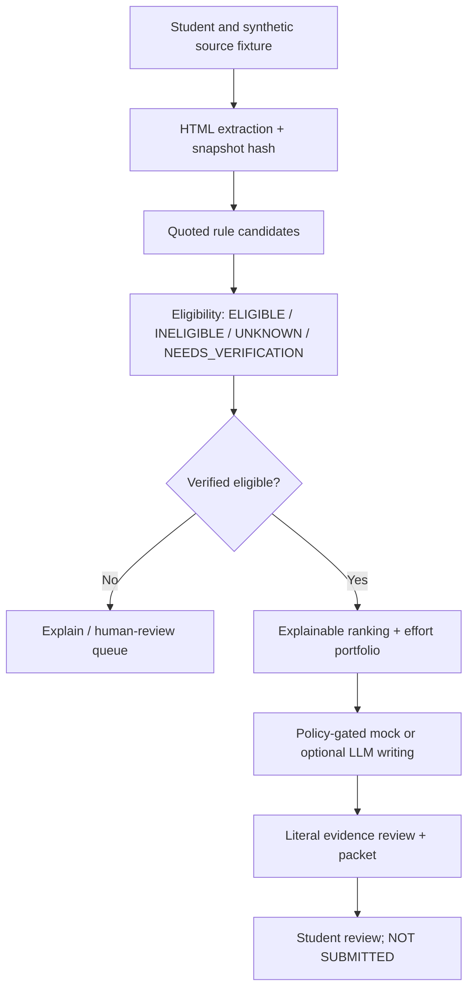

<div align="center">


# ScholarOS

**Evidence-first eligibility and application engine with skill contracts.**

*An open-source, offline-tested Python toolkit for conservative scholarship rule matching, sourced rule candidates, responsible essay assistance and application-packet preparation.*

[](https://github.com/nguyenbui1105/scholaros/actions/workflows/ci.yml)
[](pyproject.toml)
[](CHANGELOG.md)
[](LICENSE)
[](docs/STATUS.md)

[Quickstart](#-quickstart) · [Architecture](docs/ARCHITECTURE.md) · [Skills](skills/README.md) · [Status](docs/STATUS.md) · [Evaluation](docs/EVALUATION.md) · [Safety](docs/SAFETY.md)

</div>

> [!IMPORTANT]
> **Research/developer beta, not a production scholarship recommender.** The end-to-end walkthrough uses **fictional student and scholarship fixtures**. Although connector configurations point to two real institutional pages, live fetching and their current eligibility policies have not been validated end-to-end. Do not use this repository to claim eligibility, auto-submit applications, or store real student records in a deployed service.

## ✨ Implemented and tested

| Capability | Implementation | Confidence / scope |
| --- | --- | --- |
| Four-state eligibility | Normalized constraints; unknown ≠ eligible; typed reasons | Tested on synthetic records |
| Source-backed claims | HTTPS/domain screen, snapshot hash, verbatim quotes and value matching | Test fixture only; domain allowlist is **not** authenticity proof |
| Ingestion | HTML-to-text, deterministic rule candidates, quote validation | Recorded HTML tests; real fetching opt-in and untested |
| Source utilities | Freshness and award deduplication | Tested |
| Ranking | Eligible-only, explainable fit/value/ease score and effort budget | Heuristics, **not award probabilities** |
| Policy-aware writing | No writing when forbidden/unknown, disclosure gate, deterministic mock | Tested without API keys |
| Evidence review | Literal sentence-to-confirmed-evidence matching; rubric/voice diagnostics | Conservative; not semantic fact verification |
| Local storage | SQLite migration, opt-in encrypted student vault, purge command | Tested locally; not production PII security |
| CLI | `init ingest match rank explain draft review packet purge demo schemas` | Offline synthetic e2e tested |
| Skills | 20 machine-readable SKILL.md contracts | **9 tested limited, 11 specified**, not 20 autonomous agents |

See [precise status](docs/STATUS.md). A real optional OpenAI SDK adapter exists but has **no live integration test**.

## 🚀 Quickstart

Requires Python 3.11+.

```bash
git clone https://github.com/nguyenbui1105/scholaros.git
cd scholaros
python -m venv .venv
# macOS/Linux: source .venv/bin/activate
# Windows PowerShell: .venv\Scripts\Activate.ps1
python -m pip install -e ".[dev]"
scholaros demo --json
python -m pytest -q
```

Example values from the **fictional offline demo**:

```json
{
  "fixture_only": true,
  "student_id": "synthetic-student",
  "opportunity_id": "fictional-stem-award",
  "decision": "eligible",
  "ranked": [{"id": "fictional-stem-award", "score": 72.5}],
  "draft": "I practiced programming every day.",
  "review": [],
  "submission_status": "NOT_SUBMITTED"
}
```

The full JSON also contains typed reason codes. `eligible` here means only that **all encoded synthetic fixture conditions** were satisfied, not that the student qualifies for a real scholarship.

## 🔎 Explore each stage

```bash
scholaros ingest --json
scholaros match --json
scholaros rank --json
scholaros explain fictional-stem-award --json
scholaros draft --json
scholaros review --text "I won a Nobel Prize." --json
scholaros packet --json
scholaros schemas --out docs/schemas
scholaros init --db .scholaros/scholaros.db
scholaros purge synthetic-student --db .scholaros/scholaros.db --json
```

The default input is `examples/synthetic_student.json` and `examples/synthetic_scholarship.html`. CLI ingestion is offline-fixture-based, **not real provider crawling**. A separate Python connector API supports explicit opt-in live fetching with robots.txt checks, rate limiting and local cache; its live behavior is not yet independently verified. All external scholarship terms require human review.

The vault refuses storing PII unless consent is provided and `SCHOLAROS_FERNET_KEY` is set (or an explicitly insecure local-only override is set). Do not put keys or real transcripts in git.

## 🧩 Architecture



The actual code is in `src/scholaros/`. [Architecture](docs/ARCHITECTURE.md) describes trust boundaries; [RFC](docs/RFC-0001.md) describes future ambitions, not completed components.

## 🛡 Core safeguards

- Never infer missing visa, school, major, GPA, or source claims as an eligibility mismatch.
- Verified mismatches and all simultaneous unknown reasons are reported separately.
- Source quotes must match the encoded rule values; caller metadata alone is not independent proof.
- AI-use policy `unknown` and `prohibited` fail closed. Disclosure-required has an explicit checkpoint.
- AI can **only prepare** an application packet. This beta has no portal auto-submit or CAPTCHA bypass.
- Avoid storing real student PII in the current prototype; no guarantee of secure backup-level erasure.
- **No legal, immigration, or financial-aid advice. Awards are never guaranteed.**

## 🧪 Reproducibility

```bash
ruff check src tests
mypy --strict src/
pytest -q --cov=scholaros --cov-report=term-missing
python -m scholaros.benchmark
python scripts/verify_skills.py
```

A 36-pair labeled **synthetic** benchmark asserts zero false-ELIGIBLE predictions and full literal unsupported-claim detection on simple injected statements. Read [evaluation and limitations](docs/EVALUATION.md) before interpreting any numbers.

## 🛣 Next steps

Provenance-backed real institutional validation; per-provider policy verification; broader adjudicated benchmarks; encrypted, access-controlled student vault; human-centered editing UI and permissions-aware application preparation. **No autonomous submission or success-rate promises.**

[Roadmap](docs/ROADMAP.md) · [Decisions](docs/DECISIONS.md) · [Upgrade plan](docs/UPGRADE_PLAN.md)

## 🤝 Contributing

Contributions welcome: official-source rule fixtures where redistribution is permitted, falsification/ambiguity tests, accessibility improvements, scholarly evaluation, privacy/security controls. Do **not** commit real applicant records.

[Contributing guide](CONTRIBUTING.md) · [Security](SECURITY.md) · [Code of conduct](CODE_OF_CONDUCT.md) · [MIT license](LICENSE)

<div align="center"><sub>Built to amplify authentic student stories—not invent better ones. 🌱</sub></div>
