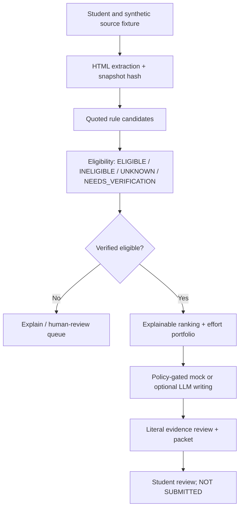

<div align="center">


# ScholarOS

**Evidence-first eligibility and application engine with skill contracts.**

*An open-source, offline-tested Python toolkit for conservative scholarship rule matching, sourced rule candidates, responsible essay assistance and application-packet preparation.*

[](https://github.com/nguyenbui1105/scholaros/actions/workflows/ci.yml)
[](pyproject.toml)
[](CHANGELOG.md)
[](LICENSE)
[](docs/STATUS.md)

[Quickstart](#-quickstart) · [Architecture](docs/ARCHITECTURE.md) · [Skills](skills/README.md) · [Status](docs/STATUS.md) · [Evaluation](docs/EVALUATION.md) · [Safety](docs/SAFETY.md)

</div>

> [!IMPORTANT]
> **Research/developer beta, not a production scholarship recommender.** The end-to-end walkthrough uses **fictional student and scholarship fixtures**. Although connector configurations point to two real institutional pages, live fetching and their current eligibility policies have not been validated end-to-end. Do not use this repository to claim eligibility, auto-submit applications, or store real student records in a deployed service.

## ✨ Implemented and tested

| Capability | Implementation | Confidence / scope |
| --- | --- | --- |
| Four-state eligibility | Normalized constraints; unknown ≠ eligible; typed reasons | Tested on synthetic records |
| Source-backed claims | HTTPS/domain screen, snapshot hash, verbatim quotes and value matching | Test fixture only; domain allowlist is **not** authenticity proof |
| Ingestion | HTML-to-text, deterministic rule candidates, quote validation | Recorded HTML tests; real fetching opt-in and untested |
| Source utilities | Freshness and award deduplication | Tested |
| Ranking | Eligible-only, explainable fit/value/ease score and effort budget | Heuristics, **not award probabilities** |
| Policy-aware writing | No writing when forbidden/unknown, disclosure gate, deterministic mock | Tested without API keys |
| Evidence review | Literal sentence-to-confirmed-evidence matching; rubric/voice diagnostics | Conservative; not semantic fact verification |
| Local storage | SQLite migration, opt-in encrypted student vault, purge command | Tested locally; not production PII security |
| CLI | `init ingest match rank explain draft review packet purge demo schemas` | Offline synthetic e2e tested |
| Skills | 20 machine-readable SKILL.md contracts | **9 tested limited, 11 specified**, not 20 autonomous agents |

See [precise status](docs/STATUS.md). A real optional OpenAI SDK adapter exists but has **no live integration test**.

## 🔎 v0.8 Scholarship lead discovery inbox (unreleased)

The localhost dashboard now includes **Discover leads**. Paste a scholarship
index page's URL and HTML that you are permitted to use: ScholarOS extracts
same-origin scholarship-like links, deduplicates them and stores an encrypted
inbox. Open each link yourself and paste its individual award content to
promote a lead into the existing source-verification queue.

**This feature does not fetch pages from the internet**. It is a link-discovery
tool over user-supplied HTML, not a live web crawler or eligibility verifier.
Every lead remains `UNREVIEWED_CANDIDATE`, every imported award remains
`NEEDS_VERIFICATION`, and every application remains `NOT_SUBMITTED`.
Read [the v0.8 workflow](docs/DISCOVERY_INBOX.md).

## 🎯 v0.7 Cited preliminary matching (unreleased)

After saving a real individual scholarship page under **My researched awards**,
open **Preliminary matching** in the localhost dashboard. For a specific
encrypted source snapshot, paste verbatim excerpts supporting the **F-1**
requirement, minimum **GPA** and **deadline**. ScholarOS performs a conservative
comparison against your encrypted student profile, reporting
`potential_match`, `potential_mismatch`, or `needs_verification`.

**Critical:** these are *self-reviewed, preliminary* screening results,
**not verified provider eligibility**. All imported awards remain
`eligibility=needs_verification` and `NOT_SUBMITTED` until independent provider
verification and any supported submission workflow. Details:
[Local cited matching guide](docs/PROFILE_TRIAGE.md).

## 🧭 v0.6 Individual-award research intake (unreleased)

Instead of being limited to a fictional award catalog, the localhost dashboard
now has **My researched awards**: paste the URL and content of a real
individual scholarship page you are permitted to use. ScholarOS encrypts the
stored text, produces a SHA-256 snapshot hash, extracts literal unverified rule
quotes and builds a checklist for manual verification. Entries are searchable,
deduplicated by URL+content hash, and kept as separate versions if text changes.

**Critical:** URL plausibility and copied text do NOT authenticate a real source
or prove eligibility. Every imported award remains `NEEDS_VERIFICATION`; no
essay or external form is automatically submitted. There is no live scraping
from this feature, and the demo agents still operate on fictional fixtures.
For setup and limitations see [source intake guide](docs/SOURCE_INTAKE.md).

## 🖥 v0.5 Student Dashboard — local browser preview

**You can now use ScholarOS through an actual browser, not only the terminal.**
It runs locally, stores your profile and packets encrypted, and allows you to
review the agent-created packet before approving it for **manual submission**.

```bash
python -m pip install -e ".[web]"
# Generate and securely keep a Fernet key; NEVER commit or share it.
export SCHOLAROS_FERNET_KEY="$(python -c 'from cryptography.fernet import Fernet; print(Fernet.generate_key().decode())')"
scholaros web
```

Open **http://127.0.0.1:8765/unlock** and enter the private access code printed in your
terminal. Windows PowerShell instructions and security limitations are in
[the v0.5 web dashboard guide](docs/WEB_UI.md).

The interface supports encrypted student onboarding, a searchable directory of
institutional scholarship-source **candidates**, running deterministic
agent roles using the **fictional demo award catalog**, and reviewing/approving
an application packet. This is **not yet a real F-1 scholarship finder, a real
scholarship application portal or an autonomous submitter**. The UI does not
request passport numbers or financial documents. No hosted multi-user access,
real-world eligibility guarantee, or external submission receipts are provided.

## 🚀 Quickstart

Requires Python 3.11+.

```bash
git clone https://github.com/nguyenbui1105/scholaros.git
cd scholaros
python -m venv .venv
# macOS/Linux: source .venv/bin/activate
# Windows PowerShell: .venv\Scripts\Activate.ps1
python -m pip install -e ".[dev]"
scholaros demo --json
python -m pytest -q
```

Example values from the **fictional offline demo**:

```json
{
  "fixture_only": true,
  "student_id": "synthetic-student",
  "opportunity_id": "fictional-stem-award",
  "decision": "eligible",
  "ranked": [{"id": "fictional-stem-award", "score": 72.5}],
  "draft": "I practiced programming every day.",
  "review": [],
  "submission_status": "NOT_SUBMITTED"
}
```

The full JSON also contains typed reason codes. `eligible` here means only that **all encoded synthetic fixture conditions** were satisfied, not that the student qualifies for a real scholarship.

## 🔎 Explore each stage

```bash
scholaros ingest --json
scholaros match --json
scholaros rank --json
scholaros explain fictional-stem-award --json
scholaros draft --json
scholaros review --text "I won a Nobel Prize." --json
scholaros packet --json
scholaros schemas --out docs/schemas
scholaros init --db .scholaros/scholaros.db
scholaros purge synthetic-student --db .scholaros/scholaros.db --json
```

The default input is `examples/synthetic_student.json` and `examples/synthetic_scholarship.html`. CLI ingestion is offline-fixture-based, **not real provider crawling**. A separate Python connector API supports explicit opt-in live fetching with robots.txt checks, rate limiting and local cache; its live behavior is not yet independently verified. All external scholarship terms require human review.

The vault refuses storing PII unless consent is provided and `SCHOLAROS_FERNET_KEY` is set (or an explicitly insecure local-only override is set). Do not put keys or real transcripts in git.

## 🧩 Architecture



The actual code is in `src/scholaros/`. [Architecture](docs/ARCHITECTURE.md) describes trust boundaries; [RFC](docs/RFC-0001.md) describes future ambitions, not completed components.

## 🔭 v0.3 source-research preview (unreleased)

ScholarOS can inspect a **registered official program landing page** from PCC Foundation or OSAC as a *read-only research source*. This produces immutable source hashes, verbatim candidate excerpts and a manual review queue. **It never automatically confirms individual scholarship eligibility.**

```bash
# Explicit opt-in to a robots-aware network request; may fail closed if disallowed
scholaros research pcc --allow-network --cache-dir .scholaros/cache --json

# Same page, from a previously saved cache; no network access
scholaros research pcc --cache-dir .scholaros/cache --json

# OSAC program-level page (not the 600+ individual awards)
scholaros research osac --allow-network --cache-dir .scholaros/cache --json
```

Live URLs and site permission must be checked before using this workflow. Offline cache content, even if it has a matching hash, is **untrusted**; output is always `needs_verification`, `verified_awards=0`, and `NOT_SUBMITTED`. No student records are needed or saved. See [source research guide](docs/RESEARCH_V03.md).

## 📊 v0.3.1 evaluation tooling (unreleased)

An **audit-first evaluation pipeline** has been implemented: source candidate discovery, permission-gated collection of **50–100 pages**, independent human annotation contracts, abstention-aware eligibility precision/recall, and offline latency and throughput benchmarking.

```bash
# Deterministic, no network, measures ingest/extract/match stage times
scholaros perf --repetitions 100 --json

# From a previously saved public HTML index, discover unapproved candidate links
scholaros discover --base-url https://onsa.asu.edu/scholarships \
  --html ./index.html --out ./candidate-manifest.json --json

# Separate, independently adjudicated gold labels from model predictions
scholaros eval-real --annotations ./annotations.jsonl \
  --predictions ./predictions.jsonl --snapshots ./snapshots --json
```

**Crucial scope:** 11 official institutional URL *candidates* are listed in the starter manifest. **No 50–100-page collection has been verified**, no independent real-world gold annotation set exists, and therefore **real-world accuracy, recall, and LLM costs are not yet measured**. These metrics remain undefined rather than silently reusing synthetic results. See [full evaluation protocol](docs/V031_EVALUATION.md) and [status](docs/STATUS.md).

## 🧭 Assisted Application Workspace (new, offline)

The new encrypted **agent workspace** supports one-time profile intake, automatic coordination of seven deterministic specialist roles, evidence-only outlines when a scholarship's AI policy is verified, prioritized review packets, and digest-bound approval. It is intentionally **not an automatic live portal-submission service**.

```bash
# Generate a Fernet key and store it privately (do not commit it to GitHub)
export SCHOLAROS_FERNET_KEY="$(python -c 'from cryptography.fernet import Fernet; print(Fernet.generate_key().decode())')"

# Enter your real facts interactively — no SSN/passport required
scholaros onboard

# Demo uses a FICTIONAL local award catalog, not real scholarship offers
scholaros autopilot --catalog examples/agent_demo_catalog.json --json

# Review encrypted packet metadata
scholaros workspace --json
```

For the full fictional walkthrough, [read the agent workspace guide](docs/AGENT_WORKSPACE.md). Real scholarship application catalogs, official-source trust, authorized destination adapters and per-packet submission receipts are **not** built yet. The assistant will never falsely report a submission.

## 🛡 Core safeguards

- Never infer missing visa, school, major, GPA, or source claims as an eligibility mismatch.
- Verified mismatches and all simultaneous unknown reasons are reported separately.
- Source quotes must match the encoded rule values; caller metadata alone is not independent proof.
- AI-use policy `unknown` and `prohibited` fail closed. Disclosure-required has an explicit checkpoint.
- AI can **only prepare** an application packet. This beta has no portal auto-submit or CAPTCHA bypass.
- Avoid storing real student PII in the current prototype; no guarantee of secure backup-level erasure.
- **No legal, immigration, or financial-aid advice. Awards are never guaranteed.**

## 🧪 Reproducibility

```bash
ruff check src tests
mypy --strict src/
pytest -q --cov=scholaros --cov-report=term-missing
python -m scholaros.benchmark
python scripts/verify_skills.py
```

An 83-pair **independently labeled synthetic** benchmark enforces **zero false-ELIGIBLE predictions** and **at least 95% unsupported-claim recall**. The v0.5 local UI CI passed **183 tests** at **86.24% statement coverage** (Python 3.11), including login, CSRF/Origin, HTML escaping, encrypted profile onboarding, agent packets and hash-bound approval tests. Synthetic eligibility results remain distinct from real scholarship performance. Read [evaluation and limitations](docs/EVALUATION.md) before interpreting any numbers.

## 🛣 Next steps

Provenance-backed real institutional validation; per-provider policy verification; broader adjudicated benchmarks; encrypted, access-controlled student vault; human-centered editing UI and permissions-aware application preparation. **No autonomous submission or success-rate promises.**

[Roadmap](docs/ROADMAP.md) · [Decisions](docs/DECISIONS.md) · [Upgrade plan](docs/UPGRADE_PLAN.md)

## 🤝 Contributing

Contributions welcome: official-source rule fixtures where redistribution is permitted, falsification/ambiguity tests, accessibility improvements, scholarly evaluation, privacy/security controls. Do **not** commit real applicant records.

[Contributing guide](CONTRIBUTING.md) · [Security](SECURITY.md) · [Code of conduct](CODE_OF_CONDUCT.md) · [MIT license](LICENSE)

<div align="center"><sub>Built to amplify authentic student stories—not invent better ones. 🌱</sub></div>
