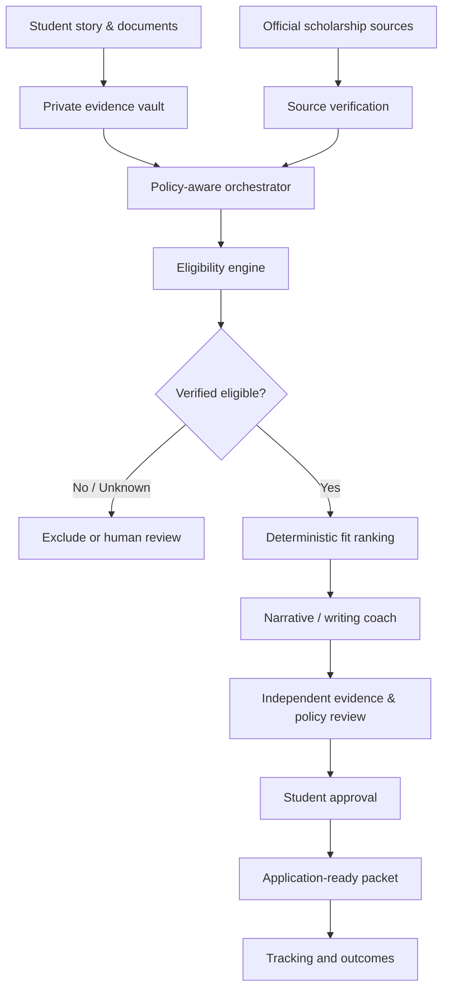

<div align="center">


# ScholarOS

**Turn your real story into a stronger scholarship strategy.**

An open-source, evidence-first AI skill system for scholarship discovery, eligibility verification, authentic writing support, and application tracking — designed with international students in the U.S. in mind.

[](https://github.com/nguyenbui1105/scholaros/actions/workflows/ci.yml)
[](pyproject.toml)
[](LICENSE)
[](docs/ROADMAP.md)
[](skills/README.md)

[Quickstart](#-quickstart) · [Architecture](docs/ARCHITECTURE.md) · [Skill Catalog](skills/README.md) · [RFC](docs/RFC-0001.md) · [Roadmap](docs/ROADMAP.md) · [Contributing](CONTRIBUTING.md)

</div>

---

> [!IMPORTANT]
> **ScholarOS is an early-stage research/engineering foundation, not a live scholarship search engine, deployed SaaS, or autonomous submission bot.** The included demo uses fictional opportunities. Always confirm current eligibility and deadlines on official sources. Scholarship providers may restrict AI-assisted writing or automation.

## ✨ What makes ScholarOS different?

| Typical workflow | ScholarOS direction |
| --- | --- |
| Keyword matching | Documented eligibility decisions with explicit unknowns |
| Generic AI essays | Story bank grounded in verified personal evidence |
| More applications at any cost | Fit, effort, value, deadline and verification-aware prioritization |
| One giant prompt | 20 independently specified skills with testable contracts |
| Silent form submission | Policy gates, user review and audit trails |
| Hype-driven success rates | Measurable quality metrics, no fabricated win probabilities |

## 🧭 System map



## 🚀 Quickstart

```bash
git clone https://github.com/nguyenbui1105/scholaros.git
cd scholaros
python -m venv .venv
# macOS/Linux: source .venv/bin/activate
# Windows PowerShell: .venv\Scripts\Activate.ps1
python -m pip install -e ".[dev]"
python -m scholaros demo
python -m pytest -q
```

The demo runs **offline**, using synthetic data and **no LLM API keys**. It demonstrates four-valued eligibility, gated ranking, and explanation output. No user's private data is checked into this repository.

## 🧠 Skill-first architecture

The [20-skill catalog](skills/README.md) spans six workflows:

1. **Student intelligence** — profile ingestion, story interviews, achievements, evidence verification
2. **Research** — opportunity discovery, eligibility, source freshness, deduplication
3. **Strategy** — fit ranking, effort/value optimization, narrative angle selection
4. **Writing** — outline, permission-aware assistance, voice preservation, rubric review
5. **Operations** — document readiness, permitted form prefill, submission readiness
6. **Evaluation** — outcomes, experiments

Every skill has a `SKILL.md` defining purpose, inputs, outputs, invariants, failure handling and acceptance checks. **Specifications are not claims that every workflow is implemented.** See [implementation status](docs/STATUS.md).

## 🔒 Non-negotiable guardrails

- Never invent eligibility, award dates, award probabilities, personal achievements, or citations.
- An **unknown** requirement is not equivalent to eligible.
- Writing behavior is constrained by each scholarship's **AI-use policy**; unknown does not mean permission.
- No application submission without explicit student approval and verified portal permission.
- No CAPTCHA bypass, anti-bot circumvention, or password harvesting.
- Store only the minimum personal data needed; never commit a real applicant's private records.

See [Safety & Privacy](docs/SAFETY.md) and [Threat Model](docs/THREAT_MODEL.md).

## 🛠 Repository contents

```text
src/scholaros/         Offline Python reference engine + CLI
skills/                20 agent-skill specifications
tests/                 Deterministic regression tests
examples/              Fictional, non-personal demo data
docs/                  RFC, architecture, ADRs, roadmap, evaluation, security
assets/                Original SVG cover art
.github/               CI, issue and PR templates
```

## 🗺 Roadmap

- **Now:** verifiable contracts, deterministic eligibility/ranking, synthetic tests, safety foundation.
- **Next:** official-source ingestion with provenance, student story vault, isolated reviewer evaluation.
- **Later:** dashboard, secure storage, permission-aware form preparation, optional human-approved automations.
- **Only after validation:** pilots and potential SaaS offering.

Follow [the full roadmap](docs/ROADMAP.md) and [contribute](CONTRIBUTING.md).

## 🤝 Contributions

Contributions welcome: eligibility edge cases, tests with **synthetic records**, source verification approaches, accessible UI prototypes and scholarly evaluation methods. Read [CONTRIBUTING.md](CONTRIBUTING.md) and [CODE_OF_CONDUCT.md](CODE_OF_CONDUCT.md).

## 📜 License

MIT — see [LICENSE](LICENSE). No affiliation with scholarship providers; no financial-aid, immigration or legal advice. An award is never guaranteed.

<div align="center"><sub>Built for students with real potential and stories worth telling. 🌱</sub></div>
