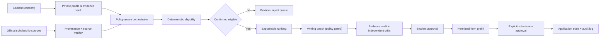

# Architecture

## Components

| Component | Responsibility | Alpha state |
| --- | --- | --- |
| Python reference core | Four-state eligibility, scoring, policy gates | Implemented |
| Opportunity ingestion | Provider-specific retrieval, canonical URL, dates, captured text and hashes | Planned |
| Student vault | Encryption, consent, per-user isolation, deletion, evidence references | Planned |
| Orchestrator | Typed skill invocation, retries, timeouts, cost limits, checkpoints | Specified |
| Essay studio | Student-owned writing workflow; policy-aware assistive tools | Planned |
| Dashboard | Accessible application pipeline and provenance | Planned |
| Application runner | Approved prefill only, portal-specific permissions, logging | Planned |

## Data safety

Split personal data plane from public opportunity data. Do not copy personal records into shared caches, public search indexes or logs. Cryptographically protect storage and transport; user-controlled deletion and export are required before hosting applicants. Human approval must be tied to exact form contents and the current portal/session.

## Ranking

Only eligible records may enter the ranking. The current weighted fit/value/ease score is explicitly a priority heuristic, **not** a likelihood of success. A future predictor requires labeled outcomes, calibration, drift evaluation and disclosure of uncertainty.

## Decision ADRs

- **ADR-001:** deterministic rule evaluation before LLM narrative judgments.
- **ADR-002:** no default autonomous submission or CAPTCHA workarounds.
- **ADR-003:** docs and skill contracts precede runtime integrations.
