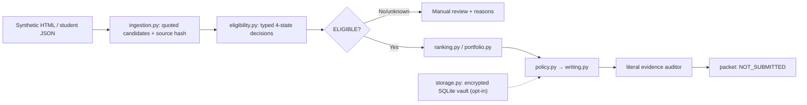

# ScholarOS v0.2 technical architecture

**Implemented offline vertical slice (fictional fixtures only)**

## Actual modules

| Module | Responsibility | Limit |
| --- | --- | --- |
| `models.py` | Eligibility dataclasses, reason codes, AI policy states | Reference model |
| `records.py` | Pydantic source/claim/requirements/profile/evidence/application schemas | Transport layer, not full persistence |
| `eligibility.py` | Unicode normalization, rule quote/value checks, source freshness and 4-state decision | Provider/source authenticity not independently established |
| `ingestion.py` | PCC/OSAC connector configs, opt-in robots-aware fetching, deterministic HTML candidates, freshness/dedup | Live fetching untested; fixtures synthetic |
| `storage.py` | SQLite migration, Fernet vault, purge | Local-only, no auth or backup-level deletion |
| `ranking.py`, `portfolio.py` | Priority score and fixed time-budget optimization | Heuristics, not award success prediction |
| `policy.py`, `writing.py` | AI permission gates, mock LLM, optional OpenAI adapter, outline/review/packet | Literal reviewer; live LLM untested |
| `workflow.py`, `__main__.py` | Offline CLI test path and JSON output | Fictional fixture, not real scholarship catalog |
| `benchmark.py` | 36-pair synthetic evaluation | Does not measure field accuracy |

## Trust boundaries

- Provider HTML and uploads are **untrusted data**, never tool/system instructions.
- HTTPS and .edu/.gov allowlist are only *plausibility checks*. The source owner, current rules and permission to fetch must be verified separately.
- A source quote must exist inside a hash-backed text snapshot and explicitly name the encoded rule; text parsing is not proof of correct legal interpretation.
- Student vault encryption requires an environment key and consent, but there is no web authentication/tenant isolation. Real PII SaaS remains out of scope.
- Writing policy is scholarship-specific. Unknown forbids AI writing; no hidden "draft anyway" fallback.
- No browser submission, OTP handling, CAPTCHA circumvention, or background auto-submission.

## Decision semantics

- Four states: `eligible`, `ineligible`, `unknown`, `needs_verification`; the current evaluator returns NEEDS_VERIFICATION for missing evidence, and INELIGIBLE only for verified hard mismatches. UNKNOWN is reserved for upstream states.
- A deadline is inclusive on the calendar date, without assuming a local cutoff hour.
- Freshness is valid at age <= `freshness_days`; future retrieval timestamps are invalid.
- Rankings only accept explicitly ELIGIBLE results. Scores have no statistical calibration.

Architecture ambition and future work: [RFC](RFC-0001.md), [roadmap](ROADMAP.md).
